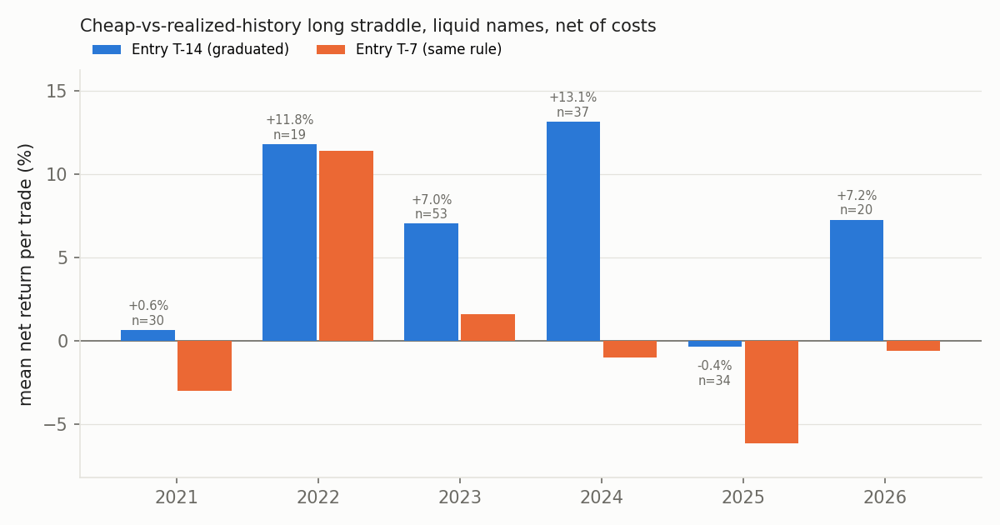
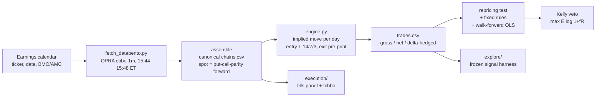
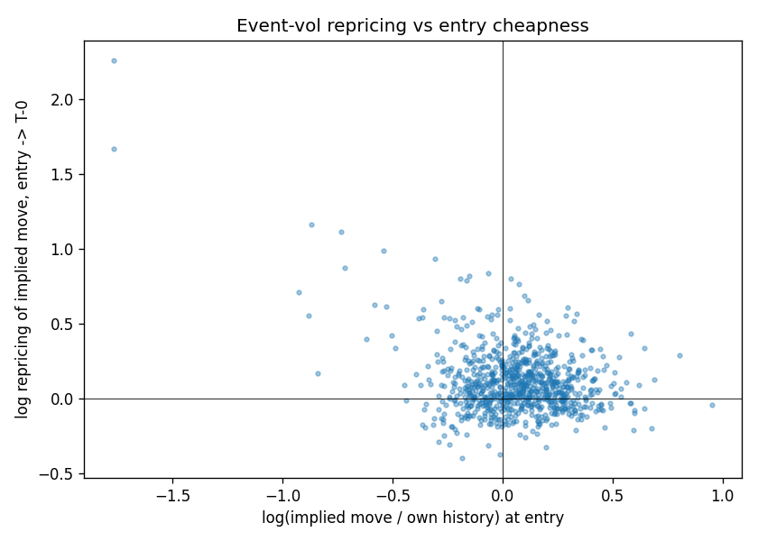

# kelly-event-vol

A Kelly-sizing engine plus an options event-volatility backtest on real OPRA quotes: it tests whether cheap pre-earnings event vol gets repriced before the announcement, and whether that is still worth trading once you pay real spreads.

## Key results

- **One rule survives costs.** In 42 liquid names (971 events, 2020-09 to 2026-08), buying the ATM straddle 14 days before earnings when the implied earnings move is at most 0.90x the name's average past realized move earns **+6.39% per trade net of half-spread fills and commissions** (n=193, t=2.65, Kelly f\* = 0.81). It is positive in **5 of 6 calendar years**, including **+11.8% in 2022**, a year when selling vol worked. It holds for both before-open (+5.6%) and after-close (+6.6%) announcements.
- **The fitted model a public strategy video promotes is worth nothing out of sample.** An expanding-window walk-forward linear model on the same signals returns **+0.01% per trade** (n=292, t=0.01, Kelly f\* = 0). The simple pre-set threshold carries all of the edge.
- **The mispricing is real in every universe, but in small caps you can't trade it.** Across 1,051 small/mid-cap names the repricing slope has t = -32.7. The same trade makes +7.4% gross and **-17.3% net** because straddles there quote about 23.5% wide as a fraction of premium. Every configuration I tested there is negative after costs.
- **Measured fills confirm the cost model; the "mid-or-better" wording is dropped.** $52.65 of OPRA `tcbbo` (trades with the quote at trade time, 539 entry days) shows only **7.7% of volume prints at mid**. The fraction of the half-spread you pay (φ) is about **0.40-0.55**, not 0. The backtest's φ = 0.5 holds up; the result turns negative if the (unmeasured) exit leg costs φ > 0.605.
- **Mining the signal gave one fragile candidate and two methodological fixes.** A 9-cell, 48-trial pre-registered sweep found one candidate, "recency anchoring": after a quiet prior quarter, big winners come about twice as often. Its apparent p = 0.00026 fell to an honest **p ≈ 0.065** once I found the season-cluster bootstrap overstates significance about 100x when there are only 2-3 effective clusters. Six hypotheses are locked for a one-shot test on a sealed holdout that has not been opened yet.
- **The result is fragile in time, and I say so.** The same rule entered at T-7 instead of T-14 earns +0.24% per trade (t=0.21). Returns are driven by the tail: the median trade is -4.9% and the top decile carries 36% of absolute P&L.



## Why this problem

Earnings options are the cleanest natural experiment in single-name vol. The event is scheduled, the implied move can be backed out of the term structure, and the realized move shows up a day later. Retail content sells both sides of it: "sell the IV crush" and "buy cheap event vol two weeks early". Neither comes with costs. The academic record (Gao-Xing-Zhang 2018; Dubinsky-Johannes-Kaeck-Seeger 2019) covers T-3 to T-1 and through-event windows. As far as I found, nobody has published a test of whether event variance priced at T-14 converges toward the name's own history. This repo tests that on real quotes with real spreads, and sizes whatever survives with the same log-utility machinery used everywhere else.

## Method



**Implied earnings move.** Variance is additive in calendar days. With $\sigma_{post}$ the ATM IV of the first expiry after the event ($T$ days) and $\sigma_{amb}$ the ambient IV (the last pre-event expiry, or the forward vol between the next two), the event variance and the implied absolute move are

$$\sigma_{evt}^2 = \frac{\sigma_{post}^2\,T - \sigma_{amb}^2\,(T-1)}{365}, \qquad \text{IM} = \sqrt{2/\pi}\;\sigma_{evt}.$$

**Why the edge has to be repricing.** `scripts/verify_vv_math.py` shows by Monte Carlo that when ambient vol is fairly priced and event vol is not repriced, an unhedged T-14 to T-0 long straddle has **zero EV before costs** (+0.04% of premium). The event variance you bought is still in the exit price, so the familiar "IV ramp" earns nothing. So

$$\mathbb{E}[\text{P\&L}] = \mathbb{E}[\text{event-vol repricing}] + (\text{ambient RV} - \text{ambient IV}) - \text{costs}.$$

At T-14, event variance is only about 33% of straddle premium. A +3% repricing of the implied move covers a 2% round-trip cost.

**Signal.** `ratio_avg_rm` = implied move at entry divided by the mean of the name's prior realized earnings moves (at least 2 priors, all strictly before entry). The rule `ratio_avg_rm <= 0.90` was fixed before the liquid run. The implied-history variant is `ratio_avg_im <= 0.90 & ratio_last_im <= 1.10`.

**Costs.** Every leg fills at $\text{mid} \pm \varphi \cdot \tfrac{1}{2}\text{spread}$, with $\varphi = 0.5$ by default, plus $0.75 per contract. The harness also reports $\varphi \in \{0, 1\}$, so the edge-versus-friction frontier is explicit.

**Kelly veto.** Every stats block reports $f^\* = \arg\max_f \mathbb{E}[\ln(1 + f R)]$ on the empirical per-trade returns. $f^\* = 0$ means don't trade. The same solver powers `toolkit/kelly.py`:

| command | what it answers |
|---|---|
| `bet` | closed-form binary Kelly, $f^\* = p/a - (1-p)/b$ |
| `scenarios` | exact joint Kelly over a scenario-return matrix (SLSQP) |
| `portfolio` | the Kelly multiple a book is *currently* running at, $\lambda = w^\top\Sigma w / w^\top\mu$ (Ledoit-Wolf $\Sigma$, CAPM-prior $\mu$) |
| `straddle` | Monte Carlo sizing of long/short straddles with IV crush, empirical or Student-t moves, `--concurrent N` joint sizing |

The sizing doctrine is to run at 0.25-0.5x Kelly. Fractional Kelly $\lambda$ keeps $2\lambda - \lambda^2$ of the growth rate: 75% of it at half Kelly, with about 12.5% probability of ever falling to half the bankroll instead of 50% (`docs/KELLY_RESEARCH.md` section 4).

## Results

**Liquid universe, T-14 entry, net at φ = 0.5** (`results/liquid_2020_2026/T14/summary.json`; 949 usable trades, median entry spread 2.9% of premium)

| configuration | mean / trade | median | n | t | Kelly f\* |
|---|---|---|---|---|---|
| cheap vs realized-move history (`ratio_avg_rm <= 0.90`) | **+6.39%** | -4.9% | 193 | 2.65 | **0.81** |
| cheap vs implied-move history | +4.41% | -10.1% | 163 | 1.26 | 0.27 |
| unconditional | +2.16% | -6.9% | 949 | 1.90 | 0.20 |
| unconditional, delta-hedged | +0.55% | -2.5% | 946 | 0.85 | 0.15 |
| walk-forward linear model (strategy-video method) | +0.01% | -7.4% | 292 | 0.01 | **0.00, veto** |
| short the crush on rich names (T-0 to T+1) | +5.55% | +20.5% | 227 | 1.35 | 0.13 |
| same rule, **T-7 entry** (`results/liquid_2020_2026/T7`) | +0.24% | -3.8% | 257 | 0.21 | 0.07 |

**Repricing channel (liquid, T-14).** Regressing $\Delta\log \text{IM}$ (entry to T-0) on $\log(\text{IM}/\text{own history})$ gives slope **-0.294 (t = -9.8, n = 852)**. The slope is negative in every year from 2021 to 2026. The cheapest quintile reprices +17.0% versus +6.7% for the richest (`repricing_by_cheapness.csv`, `repricing_by_year.csv`).



**Graduated rule by year** (`results/liquid_2020_2026/T14/rm_rule_by_year.csv`)

| year | 2021 | 2022 | 2023 | 2024 | 2025 | 2026 (to Aug) |
|---|---|---|---|---|---|---|
| n | 30 | 19 | 53 | 37 | 34 | 20 |
| mean net | +0.6% | +11.8% | +7.0% | +13.1% | -0.4% | +7.2% |

**Small/mid-cap universe, T-7 entry** (`results/smallcap_2024_2026/T7/summary.json`; 5,916 events, 3,751 usable, 2024-05 to 2026-01, median spread 23.5% of premium)

| configuration | gross | net |
|---|---|---|
| unconditional | +7.4% | **-17.3%** |
| cheap vs implied history | +3.6% | -11.7% |
| cheap vs realized history | +4.1% | -8.1% |

**Two-sided RV book** (long cheap / short rich, liquid, 2% of bankroll per trade): CAGR 7.9%, max drawdown -10.9%, Sharpe-like ratio 0.85 over 401 trades.

**Execution research** (`event_bt/execution/POLICY.md`, v2)

| finding | evidence |
|---|---|
| T-14 is the most expensive entry lead | paired penalty +17.7 bp vs T-3, CI [12.8, 22.5], 967 within-event pairs |
| "Mid-or-better fills only" is not achievable | 7.7% of volume prints at mid (CI [5.9, 9.3]) |
| φ is mostly set by the tick grid, not by negotiation | 1-tick-wide markets φ = 0.889; more than 8 ticks wide φ = 0.389 (17,194 prints) |
| φ rises with clip size | 0.403 (>= 1 lot), 0.473 (>= 10), 0.509 (>= 25) |
| Moving entry to T-10 looked cheaper; it is a weekday artifact | weekday-adjusted p = 0.771 |

## Validation & pitfalls caught

| pitfall | what I did |
|---|---|
| **Look-ahead in the signal** | Prior-move and prior-implied histories use only events strictly before entry. The walk-forward OLS fits only on trades that have already exited, with 2-year OOS blocks. |
| **Post-print contamination** | Exits happen before the announcement. Session tags are checked, and the result holds for both BMO and AMC events. |
| **Strike-band survivorship** | The synthetic selftest showed a ±10% strike band silently drops the big-move winners and biases long-straddle returns down. Assembly keeps ±30%. |
| **Fill fantasy** | Every result is shown gross and net. The φ assumption was later checked against real prints (tcbbo), which also retired the "mid-or-better" wording. |
| **Regime beta** | The rule's best year is 2022, a short-vol year. The small-cap 2024-26 sample is a buyers' regime and is labelled as such. |
| **Multiple testing** | The signal hunt uses an evaluator frozen and SHA-256-hashed before any hypothesis was written. Every probe is logged to `experiments.jsonl` *before* it is interpreted (85 logged trials). There is a registered family of m = 6, BH-FDR q = 0.10 (a lone survivor needs p <= 0.0167), and a null verdict is only allowed after at least 3 probes plus a power statement. |
| **Inference that lies at few clusters** | The season-cluster bootstrap-t turned H7's p = 0.00026 into what is really p ≈ 0.065. It was replaced by a within-season permutation test, disclosed as a between-stage amendment in `explore/FREEZE.txt`. |
| **Mislabelled features** | `dte_entry` turned out to be `ann_date - entry_date` (an entry-snap indicator), not days to expiry. The "robust" H12 finding was a data-quality artifact. The execution pack now has machine-checked column semantics, including a rule against degenerate (all-constant) detectors. |
| **Grading cost features on net P&L** | This is circular, because net contains the cost. Cost hypotheses are graded on `cost_frac`, and screens must report the gross tail they give up. |
| **Endless testing** | The execution loop spends a convergent alpha budget, $\alpha_k = 0.10 \cdot 6/(\pi^2 k^2)$ (0.076 spent of 0.10 after 2 ticks, 90 trials). |
| **Contaminated data** | The liquid panel was seen in aggregate before the signal hunt, so it is marked descriptive-only. Confirmation comes from a sealed small-cap holdout (n = 750, from 2025-07-01 on) and from prospective seasons. |

**The sealed holdout is deliberately not in this repo.** `event_bt/explore/lockbox/` holds the one-shot validation set for registered hypotheses R1-R6. It is opened exactly once, after explicit sign-off and with `LOCKBOX_OPEN=1`. The harness code that refers to it is included; the data is not. Publishing it before that single evaluation would destroy it as a test.

**Frozen-file hashes.** `FREEZE.txt` and `SHA256SUMS` record the hashes of the harnesses and panels as they were frozen. Before publication, one docstring line in each harness was changed (a local interpreter path became `python`), so the published harness bytes differ from the recorded hashes only in that line. The panel CSVs the manifests cover are not published (see below).

## Repo layout

```
toolkit/
  kelly.py                  Kelly engine: bet / scenarios / portfolio / straddle
  vol_screen.py             sell-side earnings-vol screen (IV30/RV30, term slope), BS-inverted IVs
  event_vol.py              buy-side screen + implied-move snapshot logger
  pilot.py                  decision-support console for the pilot (cannot place orders)
  backtest_earnings_vol.py  equity-only structural re-derivation of the short-crush backtest
event_bt/
  engine.py                 implied-move extraction, trade construction, stats, Kelly veto
  bt.py                     CLI: selftest / ingest / validate / cores / run
  synth.py                  synthetic option world with planted properties (for selftest)
  ingest.py                 vendor -> canonical schema adapters (ORATS, generic)
  fetch_databento.py        OPRA cbbo-1m plan / cost / fetch / assemble
  fetch_tcbbo.py            OPRA tcbbo fills pull for the execution study
  RESEARCH.md, DATA_SPEC.md literature review, pre-registered H1-H5, data plan
  explore/                  frozen signal-exploration pack (protocol, registry, harness, notes, log)
  execution/                execution-research pack (protocol, POLICY.md, harness, notes, log)
results/                    curated summaries (summary.json, repricing tables, equity curve)
figures/                    README figures
scripts/                    verify_vv_math.py (closed-form + MC checks), summarize_rm_rule.py
docs/                       KELLY_RESEARCH.md, VOLATILITY_VIBES_CHANNEL.md (source-strategy review)
examples/                   illustrative positions file and an empirical move file
```

## Reproducing

```bash
pip install -r requirements.txt

# 1. End-to-end check on a synthetic option world with planted effects (no data needed, ~2 min)
cd event_bt && python bt.py selftest --tickers 20 --quarters 16      # 6/6 PASS

# 2. Harness selftests
python explore/eval_harness.py selftest        # planted-signal / null / BH-FDR / permutation checks
python execution/exec_harness.py selftest      # 19 checks incl. semantics guards

# 3. Kelly engine and math verification
cd .. && python toolkit/kelly.py bet --p 0.6 --win 1 --loss 1 --bankroll 100000
python toolkit/kelly.py straddle --side short --hold event --spot 180 --strike 180 --dte 4 \
    --iv 0.75 --iv-exit 0.40 --entry-price 11.7 --moves-file examples/nvda_moves.csv --bankroll 100000
python scripts/verify_vv_math.py
```

**Real-data pipeline** (needs a Databento account; `export DATABENTO_API_KEY=...`):

```bash
cd event_bt
python fetch_databento.py prep-events --raw earnings.csv   # ticker,eventDate,callTime,earningsPeriod
python fetch_databento.py plan
python fetch_databento.py cost --plan data/db_plan_full.json   # prices the pull before anything is billed
python fetch_databento.py fetch --plan data/db_plan_full.json
python fetch_databento.py assemble
python bt.py validate && python bt.py run --entry-target 14,7,3
```

**Data and licensing.** OPRA quotes and trades from Databento are licensed and **not redistributed here**. That covers the raw chains, the per-trade outputs derived from them (`trades.csv`, `replicate_trades.csv`, `rvbook_trades.csv`), the execution fills panels and the exploration panels. Only aggregate summaries are published. The `cost` command prices every pull before anything is billed; the tcbbo fills study cost $52.65. Yahoo-sourced live snapshots (`implied_move_history.csv`) are not published either. The earnings calendar came from a Bloomberg export and is not included; `DATA_SPEC.md` describes the schema and alternatives (ORATS, FMP).

**Synthetic selftest caveat.** At the default size (`--tickers 30 --quarters 22`, about 3 min) the selftest's sixth check fails: the short-leg check ("short side captures planted event VRP") comes out at -5.4% gross on n = 126. The other five checks pass. At 20x16 all six pass. The rich-leg check depends on the random seed at these sample sizes, and the check needs work.

## Limitations & next steps

- **n = 193 is small and returns are tail-driven.** With this sample, only a doubling of the tail rate or a rank-IC of at least 0.25 is detectable. Plan: paper-trade a prospective season (about 60 events, with a sign test decided in advance) before sizing up. The pilot size is 1-3% of bankroll in premium per name, a quarter-Kelly ceiling, and f/N for concurrent events.
- **The entry lead matters too much.** T-14 works and T-7 does not. Until a prospective season confirms it, treat T-14 as a fixed parameter, not a robust optimum.
- **The exit-leg fill cost is unmeasured.** The net result flips sign at φ_exit = 0.605. A stratified exit-day tcbbo pull of about 200 events (around $40) would settle it.
- **All marks are near-close (15:44-15:48 ET).** Intraday timing, queue position and depth are out of scope with the data purchased.
- **The sealed holdout for R1-R6 is still unopened.** The recency-anchoring candidate stays FRAGILE until that one-shot test runs.
- The liquid universe is a fixed list of 42 names that are liquid today, not a point-in-time universe, so selection and survivorship bias are possible. The next step is a top-N-by-option-volume universe rebuilt each year.

`docs/VOLATILITY_VIBES_CHANNEL.md` reviews the public [Volatility Vibes](https://www.youtube.com/@VolatilityVibes) YouTube channel, where the long pre-earnings straddle and the short-crush screens come from. It covers each strategy's rules, the results the channel claims, and where the backtests are likely to be optimistic.
